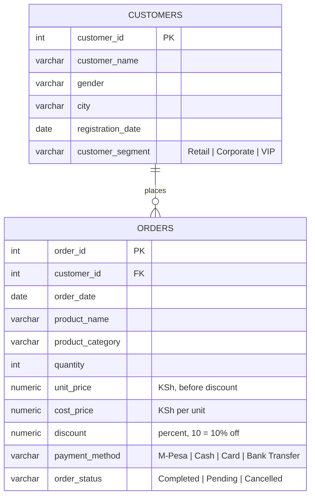

# Retail Sales & Customer Intelligence — PostgreSQL


> **A SQL-driven review of 21 months of trading for a Kenyan electronics retailer. It finds where growth is coming from, where profit is leaking, and which customers need attention now.**

**Analyst:** Calvince Okoth · [LinkedIn](https://linkedin.com/in/your-profile) · [Email](mailto:you@example.com)

---

## Table of contents

1. [Executive summary](#1-executive-summary)
2. [The business problem](#2-the-business-problem)
3. [Key findings and recommendations](#3-key-findings-and-recommendations)
4. [Recommendation roadmap](#4-recommendation-roadmap)
5. [How I did it](#5-how-i-did-it)
6. [Data model and metric definitions](#6-data-model-and-metric-definitions)
7. [SQL showcase](#7-sql-showcase)
8. [Limitations and assumptions](#8-limitations-and-assumptions)
9. [Reproduce this project](#9-reproduce-this-project)
10. [Repository structure](#10-repository-structure)

---

## 1. Executive summary

**Duka Smart Electronics** is growing fast, but growth is hiding two problems: **thin margins** and **a customer base that is quietly going inactive**.

| Metric (completed orders, Jan 2025 – Sep 2026) | Value |
|---|---|
| Revenue | **KSh 24.16M** |
| Gross profit | **KSh 2.89M** (12.0% margin) |
| Average order value | KSh 38,100 |
| Jan–Sep revenue growth, 2026 vs 2025 | **+86%** (KSh 6.89M → 12.83M) |
| Jan–Sep profit growth, 2026 vs 2025 | **+105%** (KSh 0.78M → 1.60M) |
| Active buyers, Jan–Sep 2026 vs 2025 | **47 → 113** |
| Registered customers who have bought | 88% (132 of 150) |
| Repeat-purchase rate | 70% of buyers ordered 2+ times |
| Cancelled + pending orders | 20.8% of all orders (KSh 6.6M in value) |

**The five things management should know**

1. 🔻 **Discounts are the biggest profit leak.** Orders discounted by more than 10% earned KSh 3.1M in revenue and **−KSh 27K in profit**; orders with no discount earn a 17.5% margin. Six products (TVs, the fridge, the iPhone 13 and two laptops) break even at only 9–15% off and account for **51 of the 62 sales made below cost**. A simple price floor would have added about **KSh 142K** of profit, and a 10% ceiling about **KSh 309K (+11%)**.
2. 🎧 **Accessories are the hidden profit engine.** They are 4.5% of revenue but **15.8% of profit** (42% margin), and **49% of phone and laptop buyers never bought one.**
3. 😴 **47 customers have gone quiet.** They have not bought in 90+ days and hold **KSh 4.6M (19%) of lifetime revenue**. Of these, **12 repeat buyers are overdue against their own buying rhythm** (KSh 2.6M lifetime), which makes them the best win-back targets.
4. 👑 **The top 25% of customers (38) drive 74% of revenue.** The "VIP" label doesn't identify them: 9 of the top 10 spenders are tagged *Retail*.
5. ⏳ **KSh 2.6M is stuck in "Pending".** 67 orders have been pending for 30+ days, 59 of them for 90+ days.

---

## 2. The business problem

Duka Smart Electronics sells phones, laptops, accessories, TVs and home appliances in ten Kenyan towns. It has traded since January 2025 and has never analysed its order data.

Management asked four questions:

- **Who are our best customers?**
- **Which products actually make money?**
- **Are sales growing?**
- **Which customers have stopped buying?**

This project answers them in two stages. First, **46 SQL queries** across six levels, from basic filtering to window functions and reusable database objects. Then a **27-section advanced analysis** covering KPIs, RFM segmentation, cohort retention, price-floor simulation and data reconciliation. The results become prioritised recommendations.

---

## 3. Key findings and recommendations

### 3.1 Growth is strong, and it is coming from more buyers


- Q3 2026 revenue was **KSh 5.86M, up 80%** on Q3 2025 (KSh 3.26M).
- Like-for-like (January to September), **active buyers rose from 47 to 113 (+140%)** and completed orders from 171 to 331 (+94%). The average order value slipped slightly, from KSh 40.3K to 38.8K. Growth comes from a bigger buyer base, not larger baskets.
- Margin improved from **11.4% (2025) to 12.5% (2026)**, and the average discount fell from 6.0% to 5.1%.
- **December 2025 was the peak** (KSh 2.03M), followed by an **84% drop in January 2026** (KSh 0.32M, the weakest month on record).

**Recommendation:** Plan stock and cash flow around a festive-season spike and a January slump. Run a January re-engagement campaign. With only one December on record, treat this as a pattern to confirm, not yet as proven seasonality.

---

### 3.2 Discounting is destroying margin


| Discount given | Orders | Profit margin | Sold below cost |
|---|---|---|---|
| 0% | 306 | **17.5%** | 0 |
| 5% | 103 | 13.4% | 0 |
| 10% | 128 | 6.7% | 22 |
| 15% | 52 | 2.5% | 16 |
| 20% | 34 | **−2.2%** | 14 |
| 25% | 11 | **−12.0%** | 10 |

- **62 completed orders were sold below cost**, losing KSh 142K. All had discounts of 10% or more.
- The company gave away **KSh 1.52M in discounts** (5.9% of list revenue). **45% of that (KSh 690K) went on the 97 orders above 10% off**, and those orders produced no profit.
- Discounting is not targeted. The share of orders above 10% off is about the same for Retail (15.7%), Corporate (15.2%) and VIP (14.0%) customers.

**Why a flat rule is not enough: some products have almost no room to discount.**


A product's *break-even discount* is the discount at which a sale earns zero profit. The Samsung 55" TV breaks even at 9.0%, the Hotpoint fridge at 9.5% and the Hisense 43" TV at 9.7%, so even a "standard" 10% discount sells them at a loss. **Six products account for 51 of the 62 below-cost sales.** The Hotpoint fridge alone was sold below cost in 16 of its 38 orders.

**Recommendations**

- Set a **price floor at order entry** so no order can be sold below cost.
- Set **product-specific discount ceilings** based on break-even: effectively no discount on TVs and the fridge, and at most 10% elsewhere, with manager approval above that.
- Don't assume discounts drive volume. Test it, for example by capping discounts in one city for a month and comparing.

| Policy simulated on historical data | Profit | Uplift |
|---|---|---|
| Actual | KSh 2.89M | n/a |
| **Price floor** (never sell below cost) | KSh 3.03M | **+KSh 142K (+4.9%)** |
| **10% discount ceiling** | KSh 3.20M | **+KSh 309K (+10.7%)** |

> Both are upper bounds, because they assume every customer would still have bought.

---

### 3.3 What sells is not what earns


| Category | Revenue | Margin | Share of revenue | Share of profit |
|---|---|---|---|---|
| Mobile Phones | KSh 6.94M | 10.5% | 28.7% | 25.2% |
| Computing | KSh 6.60M | 10.6% | 27.3% | 24.2% |
| Electronics | KSh 5.52M | 9.9% | 22.8% | 18.9% |
| Home Appliances | KSh 4.02M | 11.4% | 16.7% | 15.8% |
| **Accessories** | KSh 1.08M | **42.4%** | **4.5%** | **15.8%** |

- **The iPhone 13 is the top seller by revenue** (KSh 3.77M, 15.6% of the total) but makes only a **6.2% margin** and 8.1% of profit. The fridge, TVs and HP laptop have margins of 4–7%.
- **The best earners are small, cheap lines:** Oraimo Earbuds and Anker Charger (51% margin each), the JBL Flip 6 speaker (23.5%), and the Mika Blender (23.9%). The JBL Flip 6 earns 9.3% of all profit from 4.7% of revenue.
- Of 96 customers who bought a phone or laptop, **47 (49%) never bought an accessory**.

**Recommendations**

- **Bundle accessories at the till** with every phone and laptop: a charger, earbuds or a case.
- Treat high-ticket items like the iPhone, TVs and fridge as **traffic drivers**. Stop discounting them, since their margins are already 4–6%.
- Give shelf space and sales incentives to the 20%+ margin lines.

> **Impact estimate:** If each of the 47 non-buyers placed one average accessory order, the extra profit would be about **KSh 150K**. The target list is a ready-made query (section 18b of the advanced script).

---

### 3.4 A small group of customers carries the business


I split all 150 customers into value tiers with `NTILE(4)` on completed-order spending: the top quartile is **High**, the middle two are **Medium**, and the bottom quartile is **Low**. This is a relative segmentation, so no arbitrary KSh threshold is needed.

| Value tier | Customers | Spend per customer | Share of revenue |
|---|---|---|---|
| High | 38 | KSh 217K – 848K | **74.0%** |
| Medium | 75 | KSh 17K – 208K | 25.5% |
| Low | 37 | KSh 0 – 17K | 0.5% |

The Low tier includes the 18 customers who have never completed an order. The top 10 customers alone generate about 30% of revenue.

**The segment label is a poor guide to value.** Nine of the ten top spenders are tagged *Retail*. VIPs spend the most per customer (KSh 253K, against 171K for Corporate and 141K for Retail) but earn the **lowest margin (9.4%)**, because they receive the highest average discount (7.2%). Corporate accounts earn 15.3%.

#### RFM segmentation

I also scored the 132 buyers on **Recency, Frequency and Monetary value** (quintiles from 1 to 5) and grouped them into five behaviours:


| RFM segment | Customers | Share of revenue | Avg days since last order | Avg orders |
|---|---|---|---|---|
| Champions | 25 | 42.0% | 18 | 9.9 |
| Loyal / engaged | 33 | 28.6% | 42 | 5.8 |
| **At risk** | **20** | **18.4%** | **165** | **6.4** |
| Needs nurturing | 41 | 7.7% | 223 | 1.2 |
| New / promising | 13 | 3.3% | 22 | 1.3 |

The **At risk** group is the one to act on: 20 customers who used to buy often (6.4 orders on average) but haven't bought for about five months. They hold KSh 4.45M of lifetime revenue.

**Recommendations**

- **Redefine "VIP" using behaviour** (the High tier or the Champions segment) instead of a manual tag, and review it quarterly. The `customer_360` view makes this a one-line filter.
- Give top customers service, such as priority stock and an account contact, **not deeper price cuts**.

---

### 3.5 Customers are quietly leaving, but not all lapses are equal

- **47 of 132 buyers (36%)** have not placed a completed order in 90+ days. Their lifetime revenue is **KSh 4.6M (19% of the total)**.
- **A flat 90-day rule over-flags.** Repeat buyers wait about **77 days** between orders on average, because electronics are bought in occasional bursts. So I compared each lapsed customer's silence with their own typical gap:

| Lapsed customers (90+ days) | Count | What it means |
|---|---|---|
| One-time buyers | 25 | Never came back after the first purchase |
| Repeat buyers, **overdue** (silent for more than 2× their usual gap) | **12** | **KSh 2.58M lifetime revenue. Call these first.** |
| Repeat buyers, still within a normal gap | 10 | Monitor, don't chase yet |

- The overdue list includes valuable accounts, such as a VIP in Mombasa with 17 orders (≈ KSh 594K) and a Corporate account in Nairobi with 19 orders (≈ KSh 530K). Both last bought in June 2026.
- **Cohort view:** 79% of customers who ever ordered (109 of 138) came back in a later calendar month. Month-by-month retention is uneven (36% ordered again in the following month, and 25% three months later) because purchases are occasional, not a steady subscription.
- **Activation gap:** **12 customers (8% of the base) have never ordered**, and 6 more have orders but none completed.

**Recommendations**

- Start the win-back programme with the **12 overdue repeat buyers**, then the 20 RFM "At risk" customers. A personal call from an account manager suits the top 10.
- Add a **cadence-based inactivity alert** (silence of more than twice a customer's usual gap) so the sales team sees a customer drifting before they are lost.
- Contact the 12 never-ordered customers with a first-purchase offer, such as free accessories rather than a discount.

> The lapsed-customer list is query 19 and the `customer_360` view (section 26) refreshes it on demand.

---

### 3.6 Geography: Nairobi dominates


- **Nairobi generates 40% of revenue** (KSh 9.58M) from 41 buyers. Mombasa follows at 13%.
- Spend per buyer varies widely, from **KSh 234K in Nairobi to KSh 116K in Thika**.
- **Machakos** has only 3 customers but a high spend per buyer (KSh 248K). That points to a small, high-value market worth growing.

**Recommendation:** Defend Nairobi first, since it carries the business. Then target **Mombasa and Nakuru**, the two next-largest markets, for acquisition. Review Thika and Nyeri, which have the lowest spend per buyer, before investing there.

---

### 3.7 Operational flags

- **Order-status hygiene.** **76 orders (9.5%) are Pending**, and 59 of them are 90+ days old, worth about **KSh 2.35M**. A further 8 are 31–89 days old, and only 9 are recent (0–30 days). Orders this old are unlikely to still be live, so either the pipeline has a gap or statuses are not being updated. **Reported revenue may be understated, or the pipeline overstated.** Fix the workflow, then clean up the backlog.
- **Cancellations run at 11.3%** (KSh 3.47M in value). Bank-transfer orders cancel least (4 of 84 orders, 4.8%), against 12.5% for M-Pesa, the dominant method at 55% of orders. The sample is small, but it is worth checking whether M-Pesa payment prompts are failing.

---

## 4. Recommendation roadmap

| # | Action | Evidence | Estimated impact | Effort | Priority |
|---|---|---|---|---|---|
| 1 | Price floor at order entry, plus product-specific discount ceilings | 62 below-cost sales; 6 products break even at 9–15% off | **+KSh 142K** (floor) to **+KSh 309K** (10% ceiling), upper bounds | Low | 🔴 Now |
| 2 | Win back the 12 overdue repeat buyers, then the 20 "At risk" customers | KSh 2.58M and KSh 4.45M of lifetime revenue | Revenue recovery, scale depends on response | Low | 🔴 Now |
| 3 | Clear and fix the Pending backlog | 59 orders over 90 days, KSh 2.35M | Cleaner reporting, possible recovered sales | Low | 🔴 Now |
| 4 | Bundle accessories with phones and laptops | 47 buyers with no accessory | **≈ +KSh 150K** profit per bundle wave | Medium | 🟠 Next |
| 5 | Replace the "VIP" tag with a behaviour-based tier | 9 of the top 10 spenders are tagged Retail | Better-targeted loyalty spend | Medium | 🟠 Next |
| 6 | Plan stock and cash around the December peak and January dip | −84% month-on-month | Fewer stock-outs, steadier cash | Medium | 🟡 Plan |
| 7 | Review the M-Pesa cancellation rate | 12.5% vs 4.8% for bank transfer | Fewer lost sales | Medium | 🟡 Investigate |

---

## 5. How I did it

| Step | What I did |
|---|---|
| **1. Build** | Created the `retail_analytics` database and its two tables with primary keys, a foreign key, `CHECK` constraints and indexes on the join and date columns. |
| **2. Load** | Loaded 150 customers and 800 orders with idempotent scripts (`ON CONFLICT DO NOTHING`), so every script is safe to re-run. |
| **3. Validate** | Ran integrity checks before any analysis: row counts, nulls, invalid quantities, prices and discounts, orphaned orders, duplicate IDs, orders dated before registration, valid statuses and categories, and date range. All passed. |
| **4. Define metrics** | Fixed the business rules *before* writing queries so every number is consistent (see [section 6](#6-data-model-and-metric-definitions)). |
| **5. Analyse** | Answered **46 business questions** in six levels, then built a 27-section advanced analysis: KPI scorecard, RFM, cohorts, Pareto, discount economics, and win-back and activation lists. |
| **6. Reconcile** | Added a **control-total tie-out**: completed revenue is computed by total, category, city, month and customer, and every cut must equal KSh 24,155,371.70. |
| **7. Review performance** | Inspected query plans with `EXPLAIN (ANALYZE, BUFFERS)` and compared before and after an index change, rather than assuming an index helps. |
| **8. Synthesise** | Turned query output into findings, impact estimates and prioritised actions. |

**A reproducibility fix worth noting:** in the RFM query, many customers share the same purchase frequency, so `NTILE` can place tied customers into different scores from one run to the next. I added `customer_id` as a tie-breaker so the segments are identical every time.

### Skills demonstrated

| Level | Where | Techniques |
|---|---|---|
| A. Fundamentals | `duka_smart_queries.sql` Q1–Q10 | `SELECT`, `WHERE`, `DISTINCT`, `ORDER BY`, `LIMIT`, `ILIKE`, `BETWEEN` |
| B. Aggregation | Q11–Q20 | `GROUP BY`, `HAVING`, `COUNT/SUM/AVG`, `FILTER` |
| C. Joins | Q21–Q28 | `INNER JOIN`, `LEFT JOIN` (anti-join to find customers who never ordered) |
| D. Subqueries and CTEs | Q29–Q34 | Multi-step `WITH` queries, nested aggregation, recency logic |
| E. Window functions | Q35–Q42 | `RANK`, `DENSE_RANK`, `ROW_NUMBER`, `LAG`, `NTILE`, running totals, share of total |
| F. Advanced BI | Q43–Q46 | Views, PL/pgSQL functions, `CASE` segmentation, management report |
| G. Advanced analysis | `06_advanced_analysis.sql` §01–27 | KPI scorecard, RFM scoring, cohort retention, Pareto, policy simulation, `BOOL_OR`, `GREATEST/LEAST`, a reusable `customer_360` view, reconciliation checks |

---

## 6. Data model and metric definitions



**Dataset:** 150 customers across 10 towns, 800 orders, 21 products in 5 categories, 1 Jan 2025 to 30 Sep 2026. Each order row is one product line.

### Business rules applied in every query

| Measure | Definition |
|---|---|
| **Revenue** | `quantity * unit_price * (1 - discount / 100.0)` |
| **Cost** | `quantity * cost_price` |
| **Profit** | `revenue − cost` |
| **Margin %** | `profit / NULLIF(revenue, 0) * 100` |
| **Money metrics** | **Completed orders only.** Pending orders are not paid, and cancelled orders never will be. |
| **Order counts** | All statuses |
| **"Today"** | The latest `order_date` in the data (30 Sep 2026), not `CURRENT_DATE`, so results are reproducible. |
| **Lapsed customer** | Latest completed order more than 90 days before "today" |
| **Break-even discount** | `100 * (unit_price − cost_price) / unit_price`: the discount at which profit is zero |
| **Month** | Year *and* month via `DATE_TRUNC`, so January 2025 and January 2026 are never mixed. |

---

## 7. SQL showcase

A selection of the queries behind the findings. The full code is in [`sql/06_advanced_analysis.sql`](sql/06_advanced_analysis.sql) and [`sql/duka_smart_queries.sql`](sql/duka_smart_queries.sql).

### Break-even discount by product: finding 3.2

```sql
SELECT
    product_name,
    ROUND(100.0 * (unit_price - cost_price) / NULLIF(unit_price, 0), 2)
        AS break_even_discount_pct,
    ROUND(AVG(discount), 2) AS average_discount_given_pct,
    COUNT(*) AS completed_lines,
    COUNT(*) FILTER (
        WHERE discount > 100.0 * (unit_price - cost_price) / NULLIF(unit_price, 0)
    ) AS lines_sold_below_cost
FROM orders
WHERE order_status = 'Completed'
GROUP BY product_name, unit_price, cost_price
ORDER BY break_even_discount_pct;
```

### Discount policy simulation: finding 3.2

```sql
WITH scenarios AS (
    SELECT
        SUM(quantity * unit_price * (1 - discount / 100.0) - quantity * cost_price)
            AS actual_profit,
        SUM(GREATEST(quantity * unit_price * (1 - discount / 100.0),
                     quantity * cost_price) - quantity * cost_price)
            AS price_floor_profit,
        SUM(quantity * unit_price * (1 - LEAST(discount, 10) / 100.0)
            - quantity * cost_price)
            AS cap_10_profit
    FROM orders
    WHERE order_status = 'Completed'
)
SELECT ROUND(actual_profit, 2)                      AS actual,
       ROUND(price_floor_profit - actual_profit, 2) AS price_floor_uplift,
       ROUND(cap_10_profit - actual_profit, 2)      AS ten_pct_cap_uplift
FROM scenarios;
```

### RFM scoring with a deterministic tie-breaker: finding 3.4

```sql
-- Inside the rfm_scores CTE: customer_id breaks ties so segments never change between runs.
NTILE(5) OVER (ORDER BY recency_days DESC, customer_id) AS recency_score,
NTILE(5) OVER (ORDER BY frequency, customer_id)         AS frequency_score,
NTILE(5) OVER (ORDER BY monetary, customer_id)          AS monetary_score

-- Segment labels
CASE
    WHEN recency_score >= 4 AND frequency_score >= 4 AND monetary_score >= 4 THEN 'Champions'
    WHEN recency_score >= 3 AND frequency_score >= 3 THEN 'Loyal / engaged'
    WHEN recency_score <= 2 AND frequency_score >= 3 THEN 'At risk'
    WHEN recency_score >= 4 AND frequency_score <= 2 THEN 'New / promising'
    ELSE 'Needs nurturing'
END AS rfm_segment
```

### Win-back list read against each customer's own rhythm: finding 3.5

```sql
WITH anchor AS (
    SELECT MAX(order_date) AS analysis_date FROM orders
), purchase_history AS (
    SELECT customer_id,
           COUNT(*) AS completed_lines,
           MIN(order_date) AS first_purchase,
           MAX(order_date) AS last_purchase,
           SUM(quantity * unit_price * (1 - discount / 100.0)) AS lifetime_revenue
    FROM orders
    WHERE order_status = 'Completed'
    GROUP BY customer_id
), cadence AS (
    SELECT ph.*,
           a.analysis_date - ph.last_purchase AS days_inactive,
           (ph.last_purchase - ph.first_purchase)::NUMERIC
               / NULLIF(ph.completed_lines - 1, 0) AS typical_gap_days
    FROM purchase_history AS ph
    CROSS JOIN anchor AS a
)
SELECT customer_id, days_inactive, ROUND(typical_gap_days, 0) AS typical_gap_days,
       ROUND(lifetime_revenue, 2) AS lifetime_revenue_kes,
       CASE
           WHEN completed_lines = 1 THEN 'One-time buyer'
           WHEN days_inactive > 2 * typical_gap_days THEN 'Overdue vs own rhythm'
           ELSE 'Within normal gap'
       END AS winback_flag
FROM cadence
WHERE days_inactive > 90
ORDER BY lifetime_revenue DESC;
```

### One-row-per-customer view for dashboards: `customer_360`

```sql
-- Defined in section 26 of the advanced script: lifetime revenue and profit,
-- recency, an Active / Lapsed / Never purchased flag and a High / Medium / Low
-- value tier for every customer. Connect it to Power BI, Tableau or Metabase.

SELECT *
FROM customer_360
WHERE value_tier = 'High Value'
  AND activity_status = 'Lapsed (90+ days)'
ORDER BY lifetime_revenue_kes DESC;
```

---

## 8. Limitations and assumptions

- **Synthetic data.** The company, customers and orders are fictional and were generated for training. The methods and the way of thinking carry over to real work, but the numbers are not real market evidence.
- **Short history.** 21 months, with a single December and a single January. Seasonality findings are tentative.
- **Correlation, not causation.** The data shows discounts coincide with lower margin. It cannot show whether those discounts won sales that would otherwise have been lost, which is why the policy simulations are framed as upper bounds and a test is recommended.
- **Impact estimates are illustrative.** They apply simple arithmetic to historical data. They are not forecasts.
- **Lapsed is not lost.** Electronics are bought occasionally, so a 90-day silence can be normal. That is why the win-back list compares each customer with their own rhythm, but it remains a heuristic.
- **Cohort retention uses any order status.** A customer's first order and later activity count whatever its status, so retention measures engagement, not completed sales.
- **Gender field not used.** Many first names don't match the recorded gender (for example, "Caroline" recorded as Male), so I treated the field as unreliable and did no gender analysis. In a real engagement I'd raise this with the data owner.
- **Customer segments are as given.** I don't know how Retail, Corporate and VIP were assigned, which is one reason I recommend redefining them.
- **"Pending" is taken at face value.** I can't tell whether old pending orders were really paid or are just stale.

---

## 9. Reproduce this project

**Requirements:** PostgreSQL 14+ and `psql` (or pgAdmin / DBeaver).

```bash
# 1. Create the database (connect to any existing DB, e.g. postgres)
psql -U postgres -d postgres         -f sql/01_create_database.sql

# 2. Create tables, then load data (customers before orders, because of the foreign key)
psql -U postgres -d retail_analytics -f sql/02_create_tables.sql
psql -U postgres -d retail_analytics -f sql/03_insert_customers.sql
psql -U postgres -d retail_analytics -f sql/04_insert_orders.sql

# 3. Verify the load: expect 150 customers, 800 orders, 0 orphans
psql -U postgres -d retail_analytics -f sql/05_verify_data.sql

# 4. Run the analysis
psql -U postgres -d retail_analytics -f sql/duka_smart_queries.sql      # Q1-Q46
psql -U postgres -d retail_analytics -f sql/06_advanced_analysis.sql    # advanced analysis
```

All load scripts are **idempotent**: you can re-run any of them without duplicating data.

> **pgAdmin / DBeaver users:** these tools don't support the `\gexec` command in script 01. Create the database from the menu instead, then run scripts 02 onward.

**Sanity check:** after loading, completed-order revenue should be **KSh 24,155,371.70** and profit **KSh 2,890,921.70**. Section 27 of the advanced script checks that every cut of revenue ties to that figure.

---

## 10. Repository structure

```
retail-sales-sql/
├── README.md
├── images/                          # Charts used in this README
└── sql/
    ├── 01_create_database.sql
    ├── 02_create_tables.sql
    ├── 03_insert_customers.sql
    ├── 04_insert_orders.sql
    ├── 05_verify_data.sql
    ├── duka_smart_queries.sql       # The 46 business questions (Q1–Q46)
    └── 06_advanced_analysis.sql     # KPIs, RFM, cohorts, pricing, win-back, reconciliation
```

---

## Next steps

If I were extending this project:

- **Visualise it** in Power BI or Tableau as an interactive dashboard on top of the `monthly_sales_summary` and `customer_360` views.
- **Test the discount ceiling** with a controlled pilot in one city, then measure volume as well as margin.
- **Build a simple forecast** once more history is available, to support stock planning.
- **Add a basket analysis** to find which products are bought together, beyond the phone-and-accessory link.

---

*Built with PostgreSQL. All data is fictional.*
